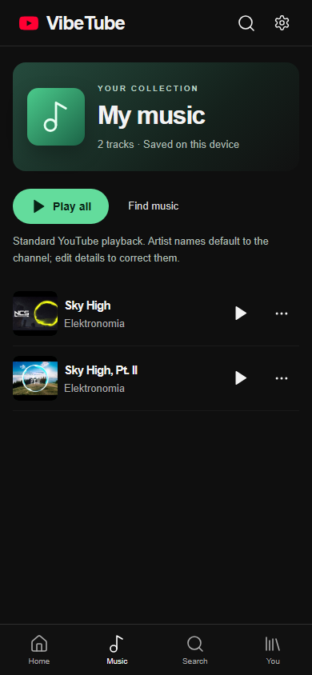

<div align="center">


**An installable video app with playback inside VibeTube.**

[](https://github.com/Mustafa1p/VibeTube-Mobile/actions/workflows/pages.yml)

[](https://mustafa1p.github.io/VibeTube-Mobile/?v=3)
[](https://mustafa1p.github.io/VibeTube-Mobile/#install-iphone)
[](https://mustafa1p.github.io/VibeTube-Mobile/#install-android)

</div>

## Watch here. Stay here.

VibeTube Mobile plays videos inside its own interface using YouTube's official embedded player. Selecting a video does **not** forward the app to youtube.com. The previous external launcher and sign-in buttons have been removed.

Install it on your Home Screen, accept the privacy notice, then search public YouTube videos, browse the collection or paste a video link. No developer API key is required.

**Playback:** VibeTube uses only the standard YouTube player. Videos request playback immediately on selection; if the browser blocks sound, the player tries muted autoplay and offers Unmute. The extra tap-to-play message is removed. Live search and channel-photo metadata use the hosting gateway. Google account sign-in and YouTube ad blocking are not provided.

| Capability                           | Current behavior                                                                |
| ------------------------------------ | ------------------------------------------------------------------------------- |
| Playback                             | Visible YouTube player embedded inside VibeTube                                 |
| Navigation                           | One player remains mounted; minimize, expand and dismiss within the app         |
| Search                               | Live public-video search through the hosted gateway; optional local-only search |
| Channel photos                       | Real channel images, loaded lazily and cached, with initials as fallback        |
| Saved videos / Watch later           | Stored locally on this device                                                   |
| Music collection                     | Artwork, titles, editable artists, play/pause and a queue; saved locally        |
| History / resume                     | Recorded from real player events where the provider exposes position            |
| Account sign-in                      | **Unavailable.** The app does not pretend to synchronize a YouTube account      |
| Whole YouTube feed / account website | Not embedded; no claim of personalized recommendations or full-site access      |
| API keys                             | None required                                                                   |
| Background playback                  | Not offered; the YouTube path pauses when the document is hidden                |

YouTube's own visible controls and links remain intact inside the embed. Videos can be unavailable, region-restricted or blocked from embedding by their creators. VibeTube reports player errors and offers Retry; it does not silently redirect playback elsewhere.

## Installation

**iPhone / iPad:** open the published link in Safari → Share → Add to Home Screen → enable Open as Web App if shown → Add. Open the VibeTube icon to access the video app.

**Android:** open the link in Chrome → use Install on Android if offered, or the browser menu → Add to Home screen / Install app. Launch the installed icon.

An ordinary browser tab shows installation instructions only. Installation buttons cannot silently add an icon. Standalone detection is a UI gate, not a security boundary.

### Updating an existing installation

When the centered **A playback update is ready** popup appears, tap **Update now**. VibeTube stops the player, applies the update and reloads automatically. **Later** keeps the current session; the popup returns when you reopen the app. Saved music and videos remain on this device. About should display **VibeTube Mobile 3.4.2**. You can also reopen [the current release](https://mustafa1p.github.io/VibeTube-Mobile/?v=3.4.2) to fetch the latest installation shell. Updates do not require a new API key or Google login.

The installed app locks page zoom and uses 16px text-entry fields to avoid search-focus enlargement. Normal scrolling remains available. See [mobile viewport verification](docs/MOBILE-VIEWPORT.md).

## Screens

### Your music collection

Tap **Add to music** on a search result or video page. Open **Music** beside Home to find saved tracks as rows with artwork, title, artist and play/pause controls. Play all, next/previous and automatic advancement use the same standard YouTube player. Song titles and artists can be edited from each row's options. Entries stay on this device; the library does not download audio or synchronize a Google account.

The music view keeps YouTube's player visible. True audio-only and background playback are unavailable. See [music behavior and verification](docs/MUSIC.md).



| Collection                                            | In-app player                                           | Local library                                         |
| ----------------------------------------------------- | ------------------------------------------------------- | ----------------------------------------------------- |
|  |  |  |

These are desktop Chromium captures with standalone mode emulated. They do not establish physical iPhone installation or background-media behavior.

## How it works

React renders navigation and the local library. `Player.tsx` keeps one standard YouTube IFrame API player mounted across screen changes. The API is prepared after consent; a ready player receives selection commands directly inside the card's click handler. Playback starts with sound when allowed. A blocked autoplay event triggers one muted retry, while the Unmute control restores sound through a user action. Browser settings can still prevent automatic playback; VibeTube does not simulate user gestures. The Home feed and Music, Films, Nature and Technology topics use public search, with 20 results per page and Load more up to five pages. Repeated video IDs are removed. The seven checked-in videos are an offline fallback. Link metadata uses that catalog or YouTube oEmbed.

Search calls the PHP gateway at `vibetubemobile.ipxer.online`, which uses yt-dlp's public search without a YouTube Data API key. Suggestions appear after a short typing delay and support normal keyboard navigation; selecting one submits the search. Suggested queries are requested from Google's YouTube autocomplete service through the gateway, using the browser language. Recent searches stay locally. Videos below playback come from a channel-name search and use smaller horizontal cards; these are not personalized YouTube recommendations. Turn live search off under **You → Playback settings** to search only the local collection.

Channel photos use validated channel IDs from search results. For older saved videos, the gateway resolves the channel through YouTube oEmbed. It reads public channel-image metadata, caches the URL for a day and returns only trusted YouTube image hosts. Images are loaded near the viewport, with three metadata requests at a time; unavailable photos retain initials. See [backend setup](backend/README.md).

The experimental HTML5 player, media relay endpoints and sponsor-skipping adapter were retired in version 3.3. Old local playback preferences no longer select a different player. Earlier investigation records remain in the verification documents; [historical license notices](public/THIRD-PARTY-LICENSES.txt) are retained.

The service worker caches a finite set of VibeTube shell assets under `/VibeTube-Mobile/`. It does not cache video streams, account data, or remote YouTube responses. New versions wait for Update now; the update action asks you to close the player before reloading.

Google receives requests when the player, thumbnails or channel photos are loaded, and may use cookies or serve ads. Live search and channel-photo lookups reach our hosting provider; search results are cached for five minutes and successful avatar metadata for a day. The player notice and settings describe these requests. VibeTube stores collections and resume positions locally; it has no Google credentials, account server, or analytics.

## Development

Requires Node.js 22 and npm.

```bash
npm ci
npm run dev
npm run format:check
npm run build
npx playwright install chromium
npm test
python backend/verify.py
```

Open the printed `/VibeTube-Mobile/` URL. Regular browser mode intentionally shows the installation guide. Tests emulate standalone mode to exercise the video app. Preview the production build with `npm run preview`.

The external real-playback test is opt-in, so CI does not mistake provider/network availability for a deterministic app test:

```powershell
$env:VIBETUBE_REAL_MEDIA='1'
npx playwright test --grep 'real playback'
$env:VIBETUBE_REAL_BACKEND='1'
npx playwright test --grep 'real hosting search'
```

GitHub Actions checks formatting, builds, runs the core browser tests and deploys the static artifact to Pages. README/docs-only changes do not redeploy application assets.

## Verification and limits

[Standard-player verification](docs/STANDARD-PLAYER.md) records the current playback and channel-photo behavior. [Deployment](docs/DEPLOYMENT.md) records published-site observations; older backend records describe retired features. Physical phone installation remains unverified in this session. Automated fixtures establish UI behavior, with real provider playback and image loading checked separately.

This is an independent app, not the full signed-in YouTube website. Full account sign-in cannot be supplied by this static embedded-player architecture. VibeTube does not claim ad blocking, forced resolution, native-app parity or guaranteed background playback.

YouTube and Google retain their trademarks and content rights. VibeTube is not affiliated with them. [YouTube terms](https://www.youtube.com/t/terms) · [Google privacy](https://policies.google.com/privacy).
