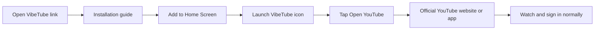
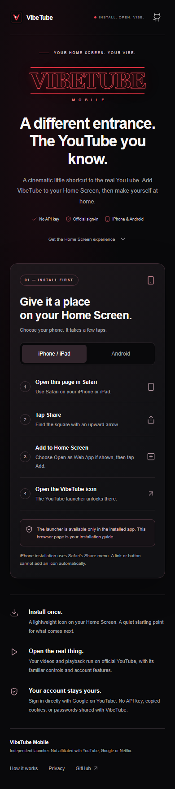
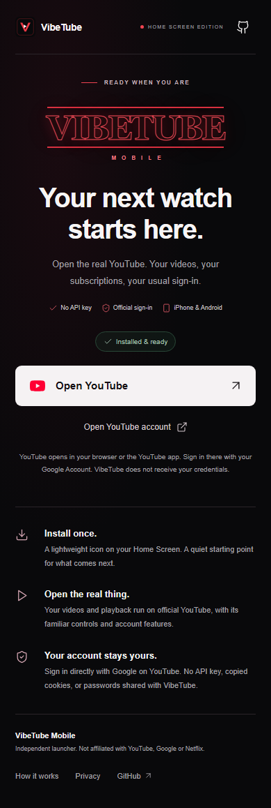
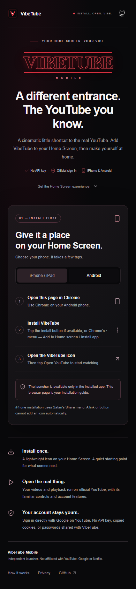

<div align="center">


**An install-first Home Screen launcher for official YouTube.**

A cinematic entrance. Familiar playback. Your normal Google account.

[](https://github.com/Mustafa1p/VibeTube-Mobile/actions/workflows/pages.yml)


[](https://mustafa1p.github.io/VibeTube-Mobile/)
[](https://mustafa1p.github.io/VibeTube-Mobile/#install-iphone)
[](https://mustafa1p.github.io/VibeTube-Mobile/#install-android)

[How it works](#how-it-works) · [Installation](#installation) · [What is different](#what-is-different) · [Development](#development) · [Verification](docs/VERIFICATION.md)

</div>

## A small launcher with a clear purpose

VibeTube Mobile gives official YouTube a dedicated starting point on your Home Screen. Open the published link to install it. Launch the installed VibeTube icon, then tap **Open YouTube** to continue on YouTube's official mobile website or app.

There is no API key to configure, no separate account to create, and no custom video service between you and YouTube. Search, videos, subscriptions, playlists and normal Google sign-in are provided by YouTube after the handoff, subject to the features available on your device and account.

> **VibeTube is a launcher.** It does not keep the full YouTube website inside a custom PWA window. Opening YouTube may switch to Safari, Chrome, another browser window, or the YouTube app. That handoff is the intended behavior.

## How it works



The browser version presents installation instructions only. The launcher controls appear when VibeTube detects standalone mode through the browser's `display-mode` signal or iOS's `navigator.standalone`. Installation eligibility and the native install interface remain under browser control. This UI gate is a product behavior, not a security boundary or a restriction on opening YouTube independently.

For account access, tap **Open YouTube account**, or use YouTube's profile icon → **Sign in**. Google handles the login directly. VibeTube cannot inspect that session, reuse your cookies, or tell whether you are signed in.

## Installation

The buttons above open the correct installation guide. They cannot silently install an app or automatically add a Home Screen icon.

### iPhone and iPad

1. Open [VibeTube Mobile in Safari](https://mustafa1p.github.io/VibeTube-Mobile/#install-iphone).
2. Tap **Share**.
3. Select **Add to Home Screen**.
4. Enable **Open as Web App** if Safari shows that option, then tap **Add**.
5. Launch **VibeTube** from the Home Screen and tap **Open YouTube**.

If the link opened inside a messaging or social app, open it in Safari first. The installation screen also explains this.

### Android

1. Open [VibeTube Mobile in Chrome](https://mustafa1p.github.io/VibeTube-Mobile/#install-android).
2. Tap **Install on Android** if Chrome offers the button. Otherwise, open Chrome's **⋮** menu and choose **Add to Home screen** or **Install app**.
3. Confirm installation, launch the new **VibeTube** icon, then tap **Open YouTube**.

The native install button appears only when the browser supplies an install prompt. Dismissing it does not unlock the browser page. Open the installed icon to use the launcher.

## What is different

| Experience                       | VibeTube Mobile                             | Official YouTube website / app                             |
| -------------------------------- | ------------------------------------------- | ---------------------------------------------------------- |
| Purpose                          | Installation guide and Home Screen launcher | Watching, discovery and account features                   |
| Branding                         | Independent cinematic VibeTube identity     | Official YouTube interface and branding                    |
| Google sign-in                   | Opens the official account destination      | Google manages your account and session                    |
| Video playback                   | Hands the link to YouTube                   | YouTube provides the player and controls                   |
| Data API keys                    | None                                        | No developer key requested from the viewer                 |
| Browser access                   | Installation information only               | Normal browser or app access                               |
| Offline behavior                 | Cached installation and launcher screens    | Media availability depends on YouTube                      |
| Background audio, PiP, downloads | Does not add or modify these capabilities   | Depend on YouTube, Premium eligibility, device and browser |

This launcher replaces the earlier custom catalog/player design. It does not maintain a separate watch history, video library, search index, or account database. Your real account activity stays with YouTube.

## Screens

<table>
<tr>
<th>Install on iPhone</th>
<th>Installed launcher</th>
<th>Install on Android</th>
</tr>
<tr>
<td width="33%"></td>
<td width="33%"></td>
<td width="33%"></td>
</tr>
</table>

Screenshots are captured in desktop Chromium. The installed view uses standalone-mode emulation; it is not proof of physical phone installation.

## Privacy and reliability

- **No account collection:** no passwords, Google tokens, API keys, analytics or account database.
- **No background requests to YouTube:** the launcher loads its own static assets; the user initiates the official-site handoff.
- **A small offline shell:** only VibeTube assets are cached. YouTube pages, streams and credentials are never cached by VibeTube.
- **Connection-aware controls:** offline installation instructions remain accessible; the installed launcher explains that YouTube needs a connection.
- **Controlled updates:** a new shell waits for the **Update now** action before reloading.
- **Subpath-safe distribution:** manifest, icons, script assets, installation links and service worker are scoped to `/VibeTube-Mobile/`.

GitHub Pages serves the app and may retain ordinary hosting logs. After a handoff, Google's privacy policy and YouTube's terms apply. The app includes a plain-language privacy dialog.

## Development

Requires **Node.js 22** and npm.

```bash
npm ci
npm run dev
```

Open the `/VibeTube-Mobile/` URL printed by Vite. A regular browser shows the installation guide; it intentionally has no launcher bypass. Automated tests emulate standalone mode to inspect the installed screen.

```bash
npm run format:check
npm run build
npx playwright install chromium
npm test
npm run preview
```

The build produces static files in `dist/`. Preview uses `http://127.0.0.1:4173/VibeTube-Mobile/`. Playwright runs a separate preview on port 4175.

```text
src/
  App.tsx          Installation, installed launcher and information dialogs
  platform.ts      Standalone mode, install prompt and connectivity detection
  style.css        Responsive layout, safe areas and reduced-motion support
public/
  manifest.webmanifest
  sw.js            Finite, versioned offline shell
  icon*.png        App icons, including an Android maskable icon
  apple-touch-icon.png
.github/workflows/pages.yml
```

## Deployment

The official GitHub Pages workflow installs from the lockfile, checks formatting, builds, runs browser tests and publishes the static artifact. It uses minimal deployment permissions and queues Pages deployments without canceling an active run.

Repository → **Settings → Pages → Source: GitHub Actions**. Push to `main` or run **Deploy VibeTube Mobile to GitHub Pages** from the Actions tab.

**Published address:** [mustafa1p.github.io/VibeTube-Mobile](https://mustafa1p.github.io/VibeTube-Mobile/).

If the repository name changes again, update the base path in Vite, the manifest, service worker, test URLs and README links together. A new path is a different PWA scope.

## Verification and practical limits

Build and automated browser checks cover installation gating, both device guides, official destination URLs, back navigation, offline recovery, manifest/icons, native-prompt dismissal, dialogs, responsive layouts and service-worker updates. See [the verification record](docs/VERIFICATION.md) for exact results and the physical-device checklist.

A browser test cannot prove Home Screen installation, a successful private Google login, every YouTube video, or future browser behavior. Real playback and sign-in take place on official YouTube. VibeTube neither guarantees those services nor changes their restrictions.

## Attribution

VibeTube Mobile is an independent project by [Mustafa1p](https://github.com/Mustafa1p). It is not affiliated with, endorsed by, or an official product of YouTube, Google or Netflix. The VibeTube wordmark and Home Screen icon are independent assets. The YouTube icon identifies the official destination; its trademark belongs to its owner and the vector is sourced from [Simple Icons](https://github.com/simple-icons/simple-icons). Runtime dependencies retain their package licenses.

Useful primary references: [YouTube on mobile browsers](https://support.google.com/youtube/answer/3008060), [Google privacy](https://policies.google.com/privacy), [YouTube terms](https://www.youtube.com/t/terms).
