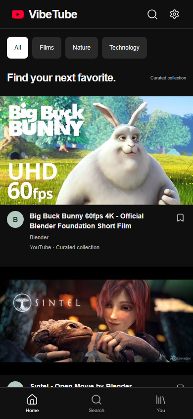
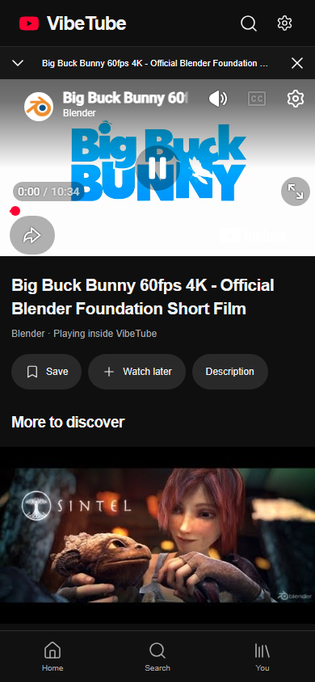
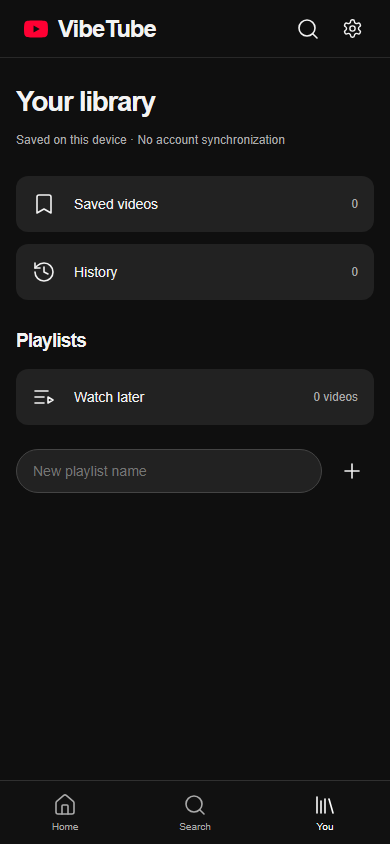

<div align="center">


**An installable video app with playback inside VibeTube.**

[](https://github.com/Mustafa1p/VibeTube-Mobile/actions/workflows/pages.yml)

[](https://mustafa1p.github.io/VibeTube-Mobile/?v=3)
[](https://mustafa1p.github.io/VibeTube-Mobile/#install-iphone)
[](https://mustafa1p.github.io/VibeTube-Mobile/#install-android)

</div>

## Watch here. Stay here.

VibeTube Mobile plays videos inside its own interface using YouTube's official embedded player. Selecting a video does **not** forward the app to youtube.com. The previous external launcher and sign-in buttons have been removed.

Install it on your Home Screen, accept the player privacy notice, then browse the curated collection or paste a YouTube video link into Search. No developer API key is required.

| Capability                           | Current behavior                                                           |
| ------------------------------------ | -------------------------------------------------------------------------- |
| Playback                             | Visible YouTube player embedded inside VibeTube                            |
| Navigation                           | One player remains mounted; minimize, expand and dismiss within the app    |
| Search                               | Searches the curated collection; accepts public video links and IDs        |
| Saved videos / Watch later           | Stored locally on this device                                              |
| History / resume                     | Recorded from real player events where the provider exposes position       |
| Account sign-in                      | **Unavailable.** The app does not pretend to synchronize a YouTube account |
| Whole YouTube feed / account website | Not embedded; no claim of personalized recommendations or full-site access |
| API keys                             | None required                                                              |
| Background playback                  | Not offered; the YouTube path pauses when the document is hidden           |

YouTube's own visible controls and links remain intact inside the embed. Videos can be unavailable, region-restricted or blocked from embedding by their creators. VibeTube reports player errors and offers Retry; it does not silently redirect playback elsewhere.

## Installation

**iPhone / iPad:** open the published link in Safari → Share → Add to Home Screen → enable Open as Web App if shown → Add. Open the VibeTube icon to access the video app.

**Android:** open the link in Chrome → use Install on Android if offered, or the browser menu → Add to Home screen / Install app. Launch the installed icon.

An ordinary browser tab shows installation instructions only. Installation buttons cannot silently add an icon. Standalone detection is a UI gate, not a security boundary.

### Updating the previous launcher

If you still see **Open YouTube** or **Sign in on YouTube**, you have the old release loaded. Tap **Update now** when it appears, then close and reopen the Home Screen app. You can also reopen [the current release](https://mustafa1p.github.io/VibeTube-Mobile/?v=3) to fetch the latest installation shell. Updates do not require a new API key or Google login.

## Screens

| Collection                                            | In-app player                                           | Local library                                         |
| ----------------------------------------------------- | ------------------------------------------------------- | ----------------------------------------------------- |
|  |  |  |

These are desktop Chromium captures with standalone mode emulated. They do not establish physical iPhone installation or background-media behavior.

## How it works

React renders the collection, navigation and local library. `Player.tsx` creates one YouTube IFrame API player and preserves it while changing screens. Metadata comes from a checked-in real-video catalog or YouTube oEmbed when a video link is supplied. Search does not claim to search all of YouTube.

The service worker caches a finite set of VibeTube shell assets under `/VibeTube-Mobile/`. It does not cache video streams, account data, or remote YouTube responses. New versions wait for Update now; the update action asks you to close the player before reloading.

Google receives requests when the player, thumbnails or metadata are loaded, and may use cookies or serve ads. The initial player notice and About dialog explain this. VibeTube stores local collections and resume positions in browser storage; it has no Google credentials, account server, or analytics.

## Development

Requires Node.js 22 and npm.

```bash
npm ci
npm run dev
npm run format:check
npm run build
npx playwright install chromium
npm test
```

Open the printed `/VibeTube-Mobile/` URL. Regular browser mode intentionally shows the installation guide. Tests emulate standalone mode to exercise the video app. Preview the production build with `npm run preview`.

The external real-playback test is opt-in, so CI does not mistake provider/network availability for a deterministic app test:

```powershell
$env:VIBETUBE_REAL_MEDIA='1'
npx playwright test --grep 'real playback'
```

GitHub Actions checks formatting, builds, runs the core browser tests and deploys the static artifact to Pages. README/docs-only changes do not redeploy application assets.

## Verification and limits

[Verification](docs/VERIFICATION.md) records local checks and real media playback. [Deployment](docs/DEPLOYMENT.md) records the published-site result. Physical phone installation remains unverified in this session.

This is an independent app, not the full signed-in YouTube website. Full account sign-in cannot be supplied by this static embedded-player architecture. VibeTube does not claim ad blocking, forced resolution, native-app parity or guaranteed background playback.

YouTube and Google retain their trademarks and content rights. VibeTube is not affiliated with them. [YouTube terms](https://www.youtube.com/t/terms) · [Google privacy](https://policies.google.com/privacy).
