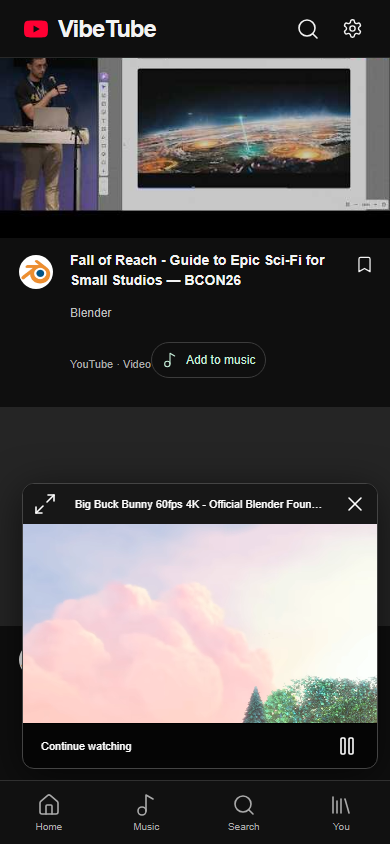
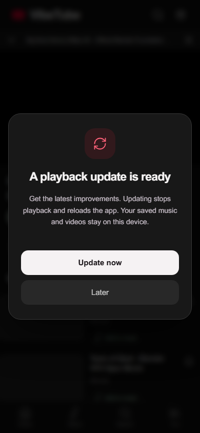

# Published VibeTube 3.5.0

**Live:** https://mustafa1p.github.io/VibeTube-Mobile/?v=3.5.0

Release 3.5.0 starts the standard player muted and offers one-tap **Unmute**. Switching videos preserves the sound choice within the mounted player. Channel names and photos open an in-app channel page with a Videos feed, pagination, retry and Back. The backend accepts a validated source video ID, resolves its official owner through YouTube metadata, and loads that owner's Videos tab. It does not substitute a text search for channel ownership.

The gateway was deployed atomically after remote PHP lint. Live checks returned twenty NoCopyrightSounds uploads per page with the correct channel ID on pages one and two. A browser check played a real Blender video muted, enabled sound in one tap and opened forty Blender uploads while retaining the iframe. [Observed results](channel-playback-verification.json). Chromium and targeted WebKit fixtures cover channel name/photo navigation, retry, pagination, reload, Back, player retention and sound controls. Physical iPhone behavior remains unverified.

## Earlier release 3.4.2 deployment

Application commit: `9239893f99ca0d2e744b5d955c67ae0d2428c327`. [Successful build and deployment](https://github.com/Mustafa1p/VibeTube-Mobile/actions/runs/39367078196).

Release 3.4.2 replaces the navigation-area update notice with a centered native modal. **Update now** stops the player before activating the waiting service worker, then reloads automatically. **Later** or Escape defers the update until the next app launch. A busy state and retryable failure message cover activation.

Seventeen Chromium checks passed locally and in CI, including a real waiting-service-worker update with a player open. A separate popup check covers 320px portrait, 390px portrait and short landscape, Escape, busy feedback and preserved storage. The same UI check passed in WebKit with a simulated waiting worker; physical iPhone update behavior remains unverified.

The published app also displayed the centered popup and requested activation in a check with a simulated waiting worker. [Observed results](update-verification.json).

The first transition from an older installation still uses that installation's existing update notice. Close its player and apply that update once to receive the new popup for future releases.

## Earlier release 3.4.1 deployment

Application commit: `151b23da97b9806b76f222853b7dc7affd796790`.

[Successful GitHub Pages build and deployment](https://github.com/Mustafa1p/VibeTube-Mobile/actions/runs/39366505388). Formatting, PHP syntax, build and sixteen deterministic Chromium tests passed in CI. Four targeted music tests also passed locally in WebKit.

## Music collection verification — 20 October 2026

The Music tab sits beside Home. Add to music works from search cards and the watch page. Saved rows contain artwork, editable titles and artist names, play/pause and a removal menu. Tracks persist on the same device. The standard visible YouTube player handles playback; this release does not supply extracted audio or background playback.

A separate check on the published app used real Elektronomia tracks, edited their artist names, reloaded the saved collection, played and paused/resumed a song, then played Next without remounting the player. It checked the actual content video ID and playback progress, excluding preroll advertisements. Artwork loaded, the player measured 354×200 at a 390px viewport, and no uncaught errors were observed. A test user may click YouTube's own available Skip control; the app does not skip ads. [Observed results](music-verification.json) · [Music behavior and limits](MUSIC.md). Physical iPhone installation/playback remains unverified.

## Earlier release 3.3.1 viewport record

Release 3.3.1 was checked on Pages in desktop Chromium with a mobile viewport, touch support and standalone detection emulated. Search and playlist inputs both had computed 16px fonts and remained at scale 1 after focus. The installed viewport requested fixed scale, root touch actions allowed panning without pinch, and no horizontal overflow or uncaught errors were observed. [Viewport observations](viewport-verification.json) · [Viewport changes and physical-device limitations](MOBILE-VIEWPORT.md). Two targeted WebKit viewport tests also passed.

## Earlier release 3.3 standard-player record

A fresh Chromium session verified release 3.3 on Pages with standalone mode emulated and an old experimental-player preference deliberately set. The app used only the standard iframe player; the real video advanced beyond 1.79 seconds without a second Play tap. Real channel photos loaded in the feed and video metadata row. The extra tap prompt was absent, zero custom-media requests were made, and no uncaught errors were observed. [Current observations](standard-player-verification.json) · [Current player and image behavior](STANDARD-PLAYER.md).

Four targeted WebKit checks passed for player UI, image loading/fallback and discovery. Physical iPhone autoplay remains unverified. Blocked autoplay triggers one muted retry; sound still follows the browser's user-activation rules.

## Earlier release 3.2 discovery record

A fresh Chromium session loaded release 3.2 on Pages with standalone mode emulated. [Current observations](discovery-verification.json) record HTTP 200, 20 Home videos, 20 Music videos, eight autocomplete suggestions, 20 first-page search results and 39 unique videos after Load more. The selected public Blender video played beyond 1.63 seconds without a second Play tap. Twenty compact recommendations appeared below it, with thumbnails approximately 164 px wide at a 390 px viewport. There were no uncaught app errors. [Discovery changes](DISCOVERY-FIX.md) explain the fixes and limits.

Separate targeted WebKit tests passed for discovery and retry. Physical iPhone behavior remains unverified. YouTube's official iframe and branding remain in use; custom server playback is still blocked by YouTube on this hosting IP.

## Earlier release 3.1 playback record

A fresh desktop Chromium session with standalone mode explicitly emulated loaded the deployed app over HTTPS. [Raw observations](live-verification.json) record:

- HTTP 200.
- The installed view displays the collection and embedded player.
- No Open YouTube launcher button and no Sign in on YouTube button.
- Actual video playback advanced to 1.45 seconds inside the iframe, then to 2.56 seconds after navigation to the local library.
- The exact iframe element remained connected during navigation; the top-level origin stayed `https://mustafa1p.github.io`.
- Saving a video produced one entry in the local saved collection.
- The application shell reloaded offline.
- No uncaught application errors were observed.

[Published playback screenshot](screenshots/published-in-app-playing.png).

The published live-search view returned eight public videos through the actual hosting gateway and browser CORS. Experimental HTML5 playback was off by default. The visible Test media server control reported extraction failure, matching the host's YouTube bot/sign-in rejection. No uncaught errors were observed. [Published backend observations](backend-live-verification.json) · [Search screenshot](screenshots/published-live-search.png) · [Backend limitations](BACKEND-VERIFICATION.md).

The embedded player retains YouTube's own native controls and branding. The app itself does not redirect video selections to the official site. Full Google/YouTube account sign-in is unavailable in this architecture and no account-handoff control is exposed.

## Updating an existing installation

Tap **Update now** in the centered popup. The app stops playback and reloads automatically. About should display **VibeTube Mobile 3.5.0**. The same manifest identity and project path are retained, so the Home Screen icon does not need to be recreated. The `?v=3.5.0` link can fetch the current installation shell in a normal browser, but watching still requires launching the installed app.

## Remaining physical check

Actual iPhone/Android installation and device playback remain unverified in this session. Install or update on a physical phone, open the Home Screen icon, accept the player notice and tap a video followed by the player's Play control. Test navigation, minimize/expand, pause, seek and fullscreen. Record device model and OS/browser version. No background-media or account-sync claim is made.
