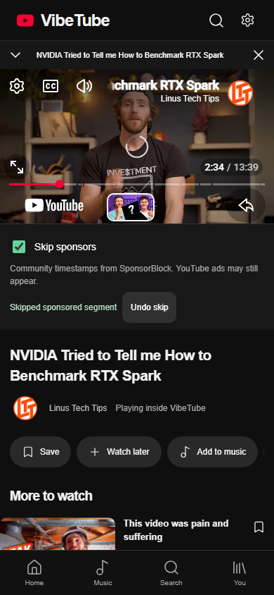

# youtube-webos research and SponsorBlock integration

The reference was inspected at commit [`f1b3b72926bb0cc312b5ceddc6a5b8c8ca081914`](https://github.com/webosbrew/youtube-webos/tree/f1b3b72926bb0cc312b5ceddc6a5b8c8ca081914). VibeTube 3.6.0 implements the portable timestamp-skipping idea through its existing YouTube iframe player. It does not bundle the webOS app or its injected code.

## What makes the TV app different

[`webpack.config.js`](https://github.com/webosbrew/youtube-webos/blob/f1b3b72926bb0cc312b5ceddc6a5b8c8ca081914/webpack.config.js) builds a `webOSUserScripts/userScript.js` entry. The app launches the YouTube TV website; [`assets/appinfo.json`](https://github.com/webosbrew/youtube-webos/blob/f1b3b72926bb0cc312b5ceddc6a5b8c8ca081914/assets/appinfo.json) configures webOS-specific privileges and cross-domain access.

Its [`adblock.js`](https://github.com/webosbrew/youtube-webos/blob/f1b3b72926bb0cc312b5ceddc6a5b8c8ca081914/src/adblock.js) replaces `JSON.parse` in that page's JavaScript context, removes ad fields from player responses, and filters advertising tiles. Its SponsorBlock implementation finds the actual video element and moves its playback position past community timestamps. Other injected modules modify the TV page's layout and controls.

An iPhone Home Screen PWA does not acquire those webOS privileges. VibeTube's JavaScript runs on its own origin, and the embedded player runs on YouTube's origin. Changing `JSON.parse`, `fetch`, CSS or a service worker on VibeTube cannot modify YouTube's separate iframe context. Consequently the TV app's ad-data filtering and logo/UI modifications are not integrated or represented as working.

## What VibeTube implements

Enable **Skip sponsors** below the player, or **You → Playback settings → Skip sponsored segments**. The preference is off initially and persists locally. The implementation:

- Computes SHA-256 of the video ID and sends only the first four hexadecimal characters to [SponsorBlock's public API](https://wiki.sponsor.ajay.app/w/API_Docs). The exact video is selected locally from the matching group.
- Requests only `sponsor` timestamps with the `skip` action; intros, outros, music and other categories are left alone.
- Rejects malformed, reversed, negative, out-of-duration or unknown-duration ranges. The reported duration must match the player's duration within two seconds before a seek is issued.
- Checks the current video ID, playing state and page visibility, combines overlapping segments, then calls the iframe API's `seekTo` method. Paused, unstarted, buffering and unmatched content do not trigger seeking.
- Places the enable switch, status and **Undo skip** outside the iframe. Undo returns to the reported segment start and permits that range to play without immediately skipping it again in the same session.
- Aborts obsolete lookups, stops its timer when disabled or unmounted, and caches successful lookups in memory for ten minutes. Missing data and lookup failures leave normal playback intact; failures offer Retry.

SponsorBlock receives the requester's IP address and hash prefix. Requests omit credentials and the referring page URL. No SponsorBlock account, submissions or voting are used. The four-character prefix reduces disclosure of the exact video; it does not make requests anonymous. Content Security Policy permits only the configured SponsorBlock origin for these requests.

This is community timestamp skipping, not YouTube-served ad blocking. Ads, player branding and native controls remain. Missing or stale community timestamps may prevent a skip. The normal iframe API does not expose a general-purpose ad-blocking interface; VibeTube does not inject into its player or claim reliable ad-state inspection.

The implementation was written independently against the public API and existing VibeTube player methods. No GPL-licensed implementation from youtube-webos was copied into the app. Its source remains separately licensed by its authors. VibeTube's older retired adapter and historical license notice are separate from this implementation.

## Verification

Twenty deterministic Chromium tests passed locally, including opt-in/persistence, hash-prefix requests, response validation, duration mismatch, paused/unstarted states, wrong-video rejection, overlap handling, automatic seek, Undo, disabled state, 404 and service outage behavior. The two targeted SponsorBlock tests also passed in WebKit. These fixtures verify UI and commands, rather than proving provider playback.

A separate browser check used real SponsorBlock timestamps for `aV81SqB6HQg`. The player skipped from the reported 138.43–154.388 second interval to its end; Undo returned to 138.43 seconds. The check seeks into the reported interval to exercise the integration without waiting through the whole video. [Observed results](sponsor-verification.json). Physical iPhone installation and playback remain unverified.

